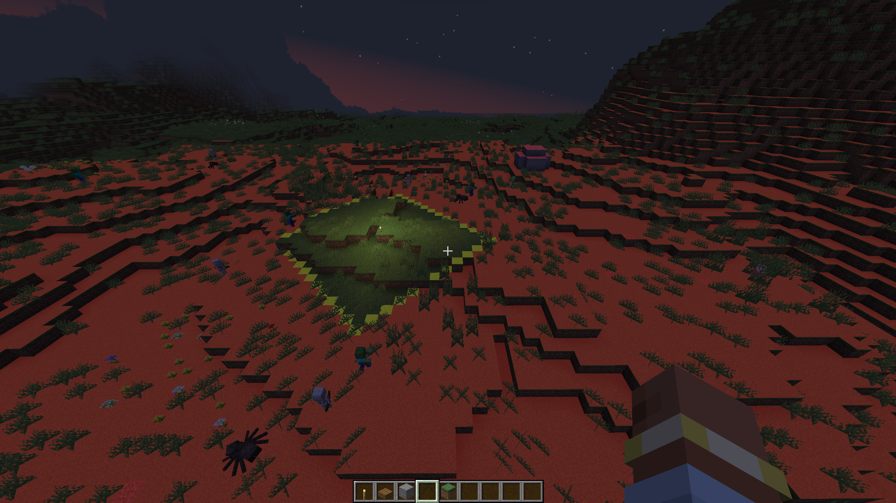

# Mob Spawn Indicator

Highlights block surfaces where hostile mobs can spawn using color-coded overlays. Client-side only.




## Supported versions

| Loader   | Minecraft versions |
|----------|--------------------|
| NeoForge | 1.21 – 1.21.11, 26.1, 26.2 |
| Fabric   | 1.21 – 1.21.8, 1.21.11 |

Fabric builds for 1.21.9, 1.21.10, 26.1 and 26.2 are not provided: those fabric-api releases ship no
world-render hook (it was removed during each of Mojang's rendering reworks and restored later), so
the overlay cannot be drawn there. Use the NeoForge build for those versions.

## Features

- Scans blocks around the player and draws colored overlays on valid spawn floors
- Color-coded by block light level at the spawn position:
  - **Red** — block light 0 (mobs can spawn at night)
  - **Yellow** — block light 1 (spawns only if other conditions suppress light)
  - **Green** — block light 2+ (safe)
- Uses vanilla spawn rules — respects slabs, stairs, glass, leaves, and other non-spawnable blocks
- Configurable render radius and overlay opacity
- Toggle on/off with keybind (default: `J`)
- Shows danger, warning, and safe zones independently

## Usage

Press `J` (default) to toggle the overlay on/off. All valid spawn floors within range will be highlighted.

Client-side commands:
- `/msi on` — enable the overlay
- `/msi off` — disable the overlay
- `/msi toggle` — toggle the overlay
- `/msi reset` — reset the overlay to default settings
- `/msi settings` — open the settings screen

The settings screen is reachable from the mod list (built into NeoForge's mods screen,
[Mod Menu](https://modrinth.com/project/modmenu) on Fabric) or via `/msi settings`.

## Configuration

`config/msi-common.toml` — same file and keys on both loaders, or change values in the settings screen:

- `renderRadius` — scan radius in blocks, 4–64 (default: 16)
- `overlayOpacity` — overlay transparency, 0.05–1.0 (default: 0.5)
- `showDanger` — show red zones (default: true)
- `showWarning` — show yellow zones (default: true)
- `showSafe` — show green zones (default: false)

## Building

Requires a JDK 25+ to run Gradle (JDK 21/25 toolchains for the targets are provisioned automatically
via [foojay](https://github.com/gradle/foojay-toolchains)). Node projects live under `versions/`,
generated by [Stonecutter](https://stonecutter.kikugie.dev/).

```sh
./gradlew build                      # build every registered target
./gradlew :1.21.1-neoforge:build     # build one target
./gradlew :1.21.1-neoforge:runClient # run a client for one target
```

Compile targets are the last version of each API-compatible group; each jar's metadata covers the
in-between patches (e.g. the `1.21.8` build runs on 1.21.6–1.21.8).

## Architecture

```
src/main/kotlin/org/fnzero/msi/
├── MsiState.kt              # shared state + status messages (loader-agnostic)
├── MsiConfig.kt             # TOML config via NightConfig, shared by both loaders
├── MsiKeys.kt               # keybind creation (registration is per loader)
├── SpawnChecker.kt          # spawn rule scanning (loader-agnostic)
├── SpawnRenderer.kt         # overlay rendering (version-gated per MC generation)
├── client/gui/              # settings screen + icon button
├── fabric/                  # ClientModInitializer + ModMenu entry (`//? if fabric`)
└── neoforge/                # @Mod entry + NeoForge event glue (`//? if neoforge`)
```

Loader-specific code lives in `fabric/` and `neoforge/` packages, gated with whole-file Stonecutter
conditions; per-Minecraft-version API differences are gated inline with version comparisons
(`//? if >=1.21.11 { ... //?}`). Every node compiles the preprocessed generated sources, so the
active version choice does not affect build output.
