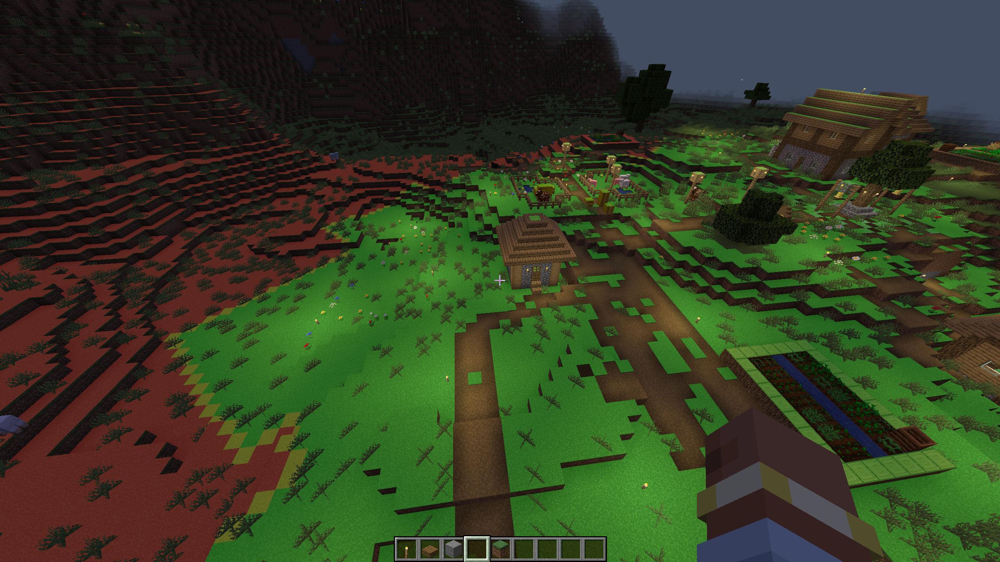

# Mob Spawn Indicator

Highlights block surfaces where hostile mobs can spawn using color-coded overlays. Client-side only, requires NeoForge 1.21.1.




## Features

- Scans blocks around the player and draws colored overlays on valid spawn floors
- Color-coded by block light level at the spawn position:
  - **Red** — block light 0 (mobs can spawn at night)
  - **Yellow** — block light 1 (spawns only if other conditions suppress light)
  - **Green** — block light 2+ (safe)
- Uses vanilla spawn rules — respects slabs, stairs, glass, leaves, and other non-spawnable blocks
- Configurable render radius and overlay opacity
- Toggle on/off with keybind (default: `J`)
- Shows danger, warning, and safe zones independently

## Usage

Press `J` (default) to toggle the overlay on/off. All valid spawn floors within range will be highlighted.

Client-side commands:
- `/msi on` — enable the overlay
- `/msi off` — disable the overlay
- `/msi toggle` — toggle the overlay
- `/msi reset` — reset the overlay to default settings
- `/msi settings` — open the settings screen

## Configuration

Edit `config/msi-common.toml` or use a mod menu:

- `render_rad` — scan radius in blocks (default: 16)
- `overlay_opacity` — overlay transparency (default: 0.5)
- `show_danger` — show red zones (default: true)
- `show_warn` — show yellow zones (default: true)
- `show_safe` — show green zones (default: false)

## Build

Requires JDK 21.

```sh
./gradlew build
./gradlew runClient
```
